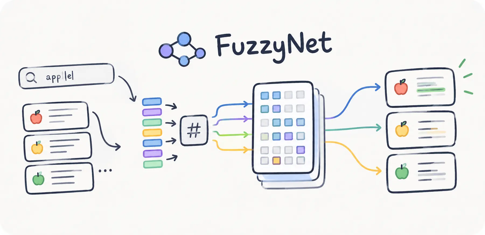

<div align='center'>



[](https://deno.com) [](https://nodejs.org) [](https://bun.sh) [](https://developer.mozilla.org/en-US/docs/Web/JavaScript)

</div>

## What is Fuzzy-Net?

Fuzzy-Net is a lexical search index that stores each string as a document bit and finds a query by projecting hashed tokens onto those bits, so a misspelled word can still match when enough of its bytes remain.

## Installation

**Deno:**

```bash
deno add npm:@neabyte/fuzzy-net
```

**npm:**

```bash
npm install @neabyte/fuzzy-net
```

**CDN (jsDelivr/esm.sh):**

```html
<script type="module">
  import FuzzyNet from 'https://cdn.jsdelivr.net/npm/@neabyte/fuzzy-net/dist/index.mjs'
</script>
```

Or via [esm.sh](https://esm.sh):

```html
<script type="module">
  import FuzzyNet from 'https://esm.sh/@neabyte/fuzzy-net'
</script>
```

## Usage

```ts
import FuzzyNet from '@neabyte/fuzzy-net'

// Build index from five product names
const index = new FuzzyNet([
  'red ceramic coffee mug',
  'blue ceramic tea cup',
  'linen kitchen towel',
  'oak dining chair',
  'wool winter scarf'
])

console.log(index.search('ceramic mug', 2))
// [
//   { value: 'red ceramic coffee mug', score: 16 },
//   { value: 'blue ceramic tea cup', score: 12 }
// ]

console.log(index.search('cermaic', 1))
// [{ value: 'red ceramic coffee mug', score: 8 }]

console.log(index.search('xoffee', 1))
// [{ value: 'red ceramic coffee mug', score: 12 }]
```

`limit` defaults to `10`, a limit of `0` or below returns `[]`, and a query with no byte features also returns `[]`.

## API

### `new FuzzyNet(values)`

| Parameter | Type                | Description                                                 |
| --------- | ------------------- | ----------------------------------------------------------- |
| `values`  | `readonly string[]` | Strings to index. Position in the array is the document id. |

The table is built once, and `search` does not change the indexed strings.

### `index.search(query, limit?)`

| Parameter | Type     | Description                                                     |
| --------- | -------- | --------------------------------------------------------------- |
| `query`   | `string` | Query text. A token ends on a byte whose top two bits are `00`. |
| `limit`   | `number` | Optional. How many results to return. Default `10`.             |

**Returns:** `FuzzyResult[]`, highest score first.

```ts
type FuzzyIndex = {
  search: (query: string, limit?: number) => FuzzyResult[]
}

type FuzzyResult = {
  value: string
  score: number
}
```

`value` is the original indexed string and `score` is the overlap stage mask, so when two scores are equal the earlier one in the scan stays ahead.

## Build

```bash
npm run build
```

## Testing

```bash
deno task check
```

```bash
deno task test
```

## License

This repository is licensed under [Apache 2.0](./LICENSE).
